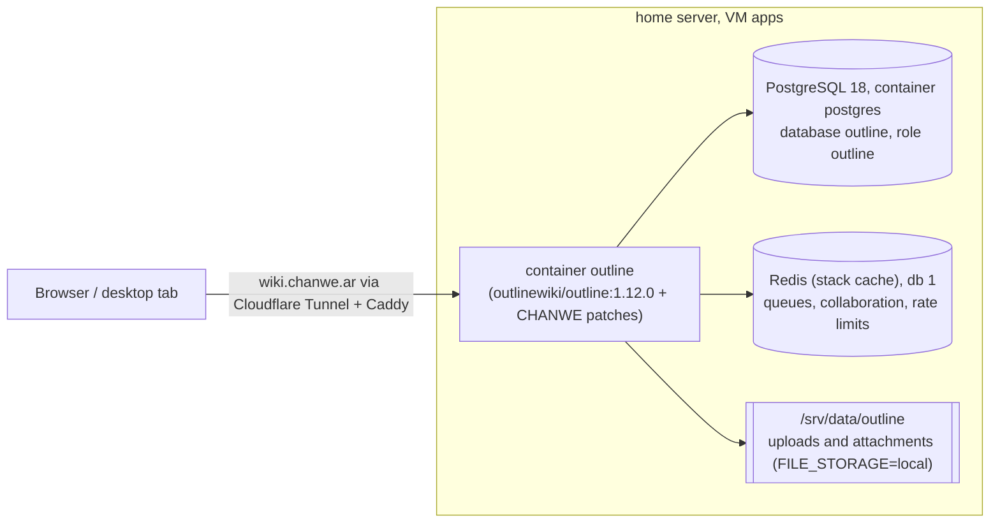
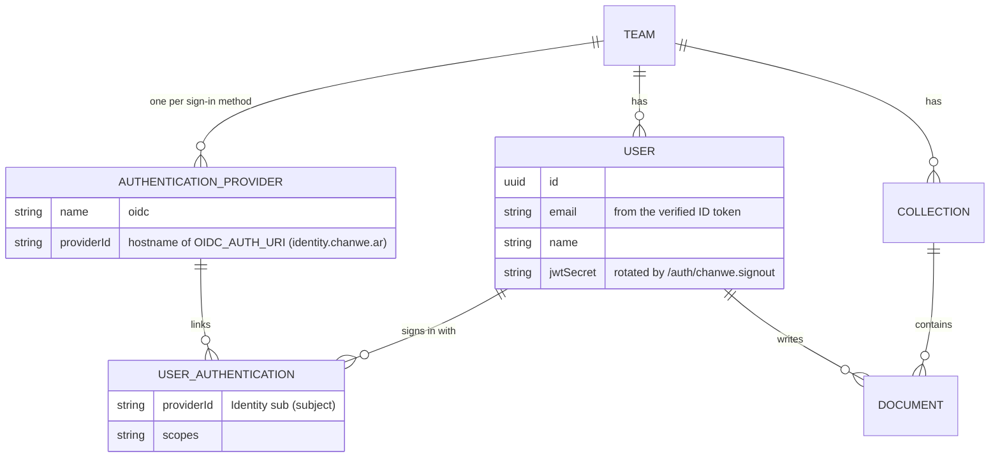
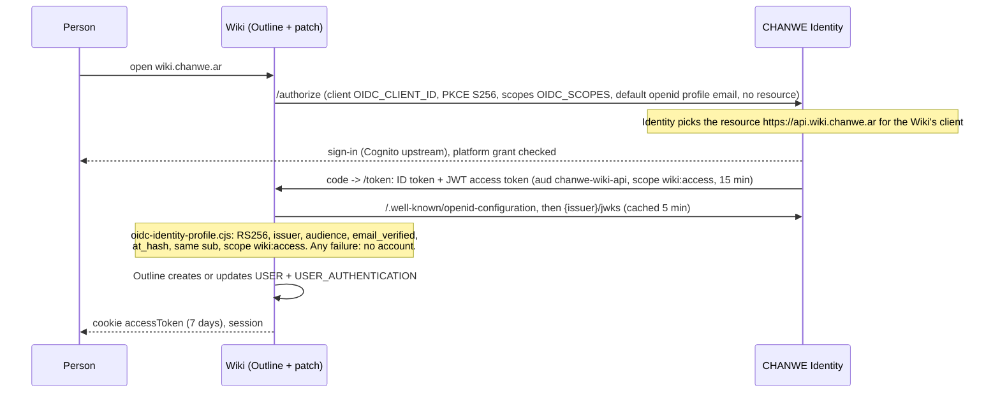
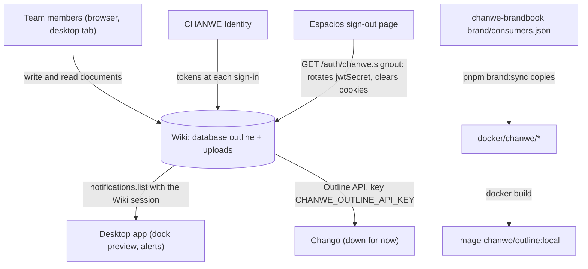

# Data tree: CHANWE's Wiki

[Español](../es/data-tree.md) · Checked against the code on **2026-11-03** (this repo's `docker/`, `Dockerfile`,
`chanwe-proxmox-server/stacks/outline`, Identity's `src/domain/authorization/scopes.ts`). Live row counts and the server's
actual `.env` were not checked.

Outline owns its schema (`server/models`, migrations run automatically at start). CHANWE adds **no tables and no
columns**: its layer decides who may get an account (Identity's tokens), how long a session lasts and how the pages look.

## 1. Where the data lives

## 2. Entities that CHANWE's layer touches

These are Outline's own models; the diagram shows only the keys that matter for the Identity sign-in.

## 3. Where a Wiki account comes from

The userinfo endpoint is **not** called: the access token is meant for the Wiki resource, so the profile comes from
the verified ID token (`sub`, `email`, name claims).

## 4. Who writes and reads

| Data | Source | Writer | Readers |
|---|---|---|---|
| Documents, collections, comments | People in the Wiki | Outline | Team, desktop (notifications), Chango |
| Users and their Identity link | Identity's ID token at sign-in | Outline (after the CHANWE check) | Outline |
| Session (`accessToken` cookie, `sessions` cookie) | Sign-in | Outline, 7-day expiry (patched) | Outline; cleared by `/auth/chanwe.signout` |
| Uploads | People | Outline, `/srv/data/outline` | Outline |
| Brand files | `chanwe-brandbook` | `pnpm brand:sync` in the brandbook | Image build |
| Secrets (`SECRET_KEY`, `UTILS_SECRET`, `OIDC_CLIENT_SECRET`, DB password) | Server stack `.env`, chanwe-locker | Ale | Container |
