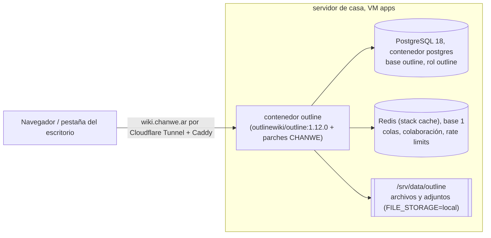
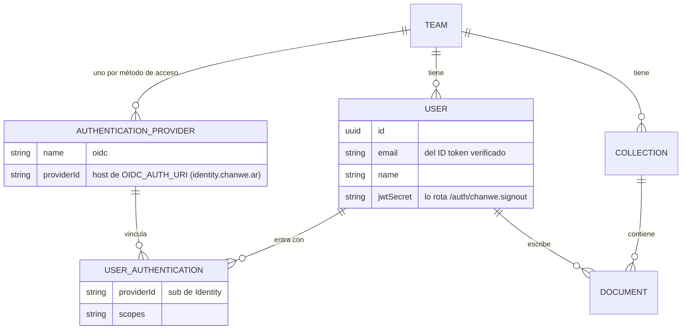
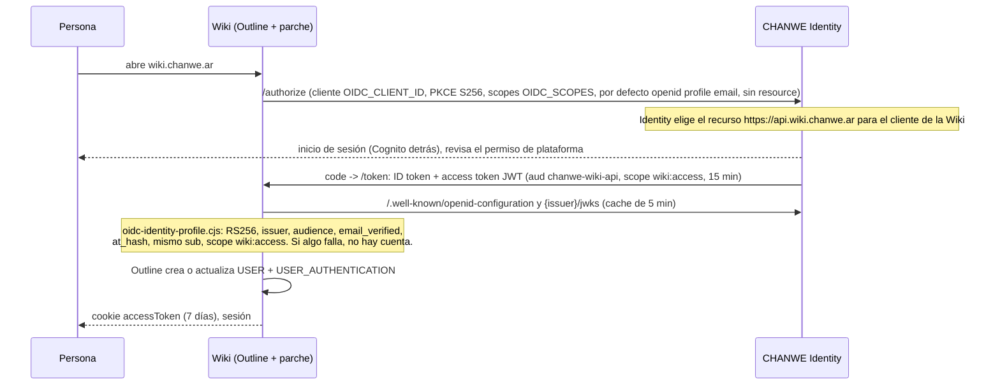
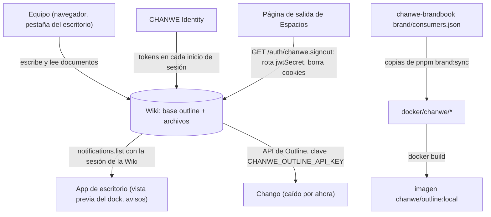

# Árbol de datos: la Wiki de CHANWE

[English](../en/data-tree.md) · Revisado contra el código el **2026-11-03** (`docker/` y `Dockerfile` de este repo,
`chanwe-proxmox-server/stacks/outline`, `src/domain/authorization/scopes.ts` de Identity). No revisé cantidades de filas
en vivo ni el `.env` real del servidor.

El esquema es de Outline (`server/models`; las migraciones corren solas al arrancar). CHANWE **no agrega tablas ni
columnas**: su capa decide quién puede tener cuenta (los tokens de Identity), cuánto dura una sesión y cómo se ven las
páginas.

## 1. Dónde viven los datos

## 2. Entidades que toca la capa de CHANWE

Son modelos de Outline; el diagrama muestra solo las claves que importan para entrar con Identity.

## 3. De dónde sale una cuenta de la Wiki

**No** se llama a userinfo: el access token es para el recurso de la Wiki, así que el perfil sale del ID token
verificado (`sub`, `email`, claims de nombre).

## 4. Quién escribe y quién lee

| Dato | Origen | Quién lo escribe | Quién lo lee |
|---|---|---|---|
| Documentos, colecciones, comentarios | La gente en la Wiki | Outline | Equipo, escritorio (notificaciones), Chango |
| Usuarios y su vínculo con Identity | ID token de Identity al entrar | Outline (después del control de CHANWE) | Outline |
| Sesión (cookies `accessToken` y `sessions`) | Inicio de sesión | Outline, vence a los 7 días (parche) | Outline; las borra `/auth/chanwe.signout` |
| Archivos subidos | La gente | Outline, en `/srv/data/outline` | Outline |
| Archivos de marca | `chanwe-brandbook` | `pnpm brand:sync` en el brandbook | El build de la imagen |
| Secretos (`SECRET_KEY`, `UTILS_SECRET`, `OIDC_CLIENT_SECRET`, clave de la base) | `.env` del stack, chanwe-locker | Ale | El contenedor |
